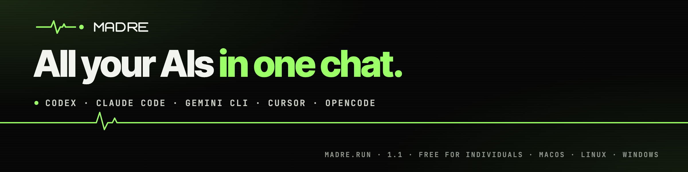
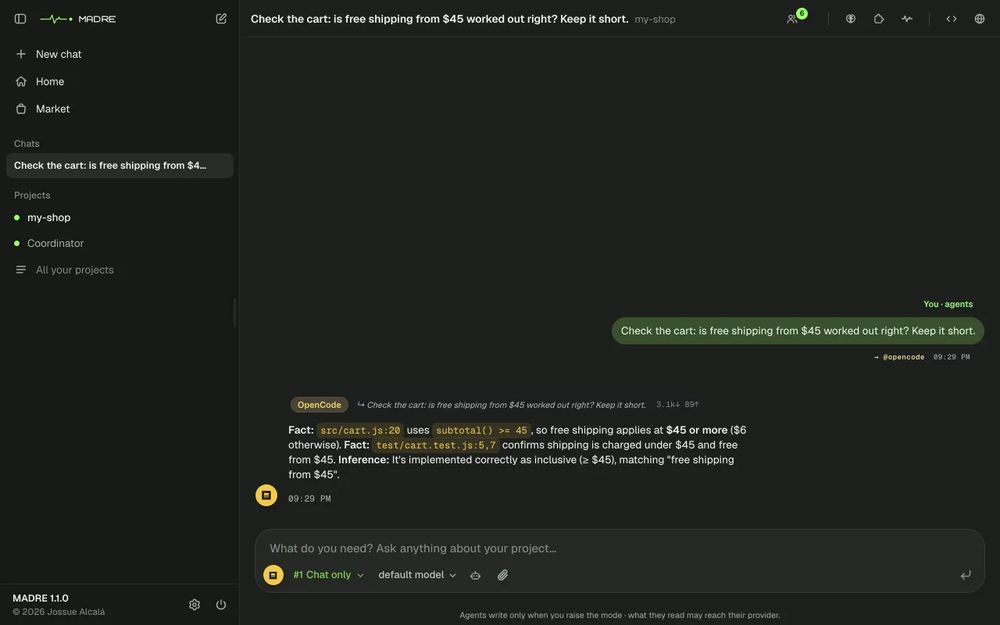
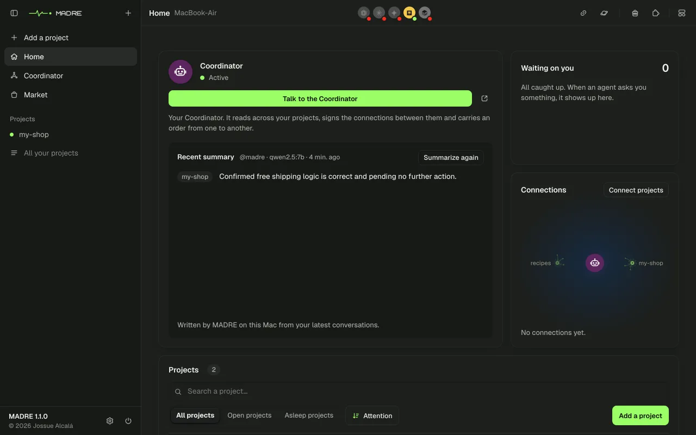
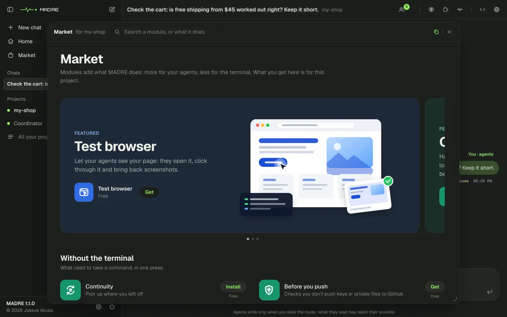
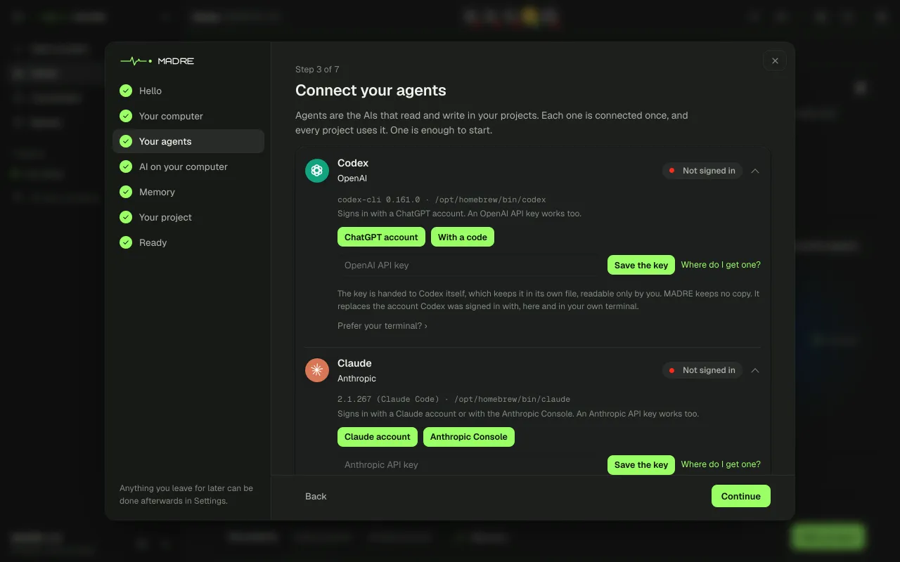
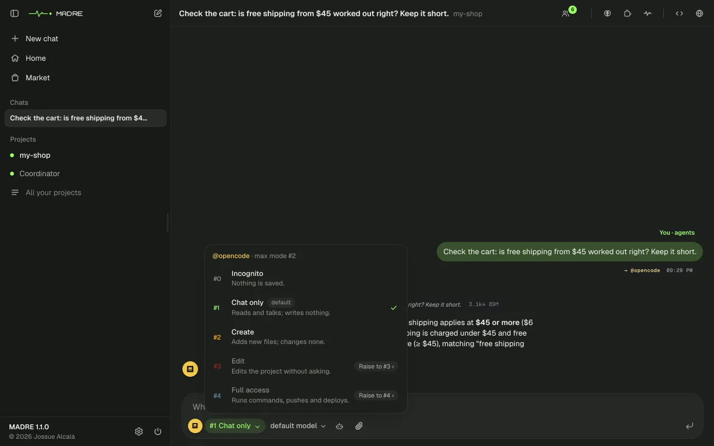

<p align="center">
  <a href="https://madre.run"></a>
</p>

<p align="center"><a href="README.md">Español</a> · <b>English</b></p>

<p align="center">
  <a href="https://www.npmjs.com/package/@jossuealcala/madre"></a>
  <a href="https://github.com/jossuealcacao-exe/madre/actions/workflows/ci.yml"></a>
  
  
</p>

# All your AIs in one chat.

**MADRE is not another AI.** It is an app that runs on your computer and brings the AIs you already use (Codex, Claude Code, Gemini, Cursor and OpenCode) into one chat, inside your project. You write to them in your own words, each one reads what the others said, and you decide what they may change. What gets decided is kept.

<p align="center">
  
</p>

## Install it

**macOS and Linux.** Open the Terminal and type:

```
npx @jossuealcala/madre
```

**Windows.** Download the installer from [madre.run/en/windows](https://madre.run/en/windows) and open it with a double click. It turns on WSL2 (the Linux that comes with Windows) if needed, prepares MADRE's Linux and leaves it in the Start menu, with no terminal. Prefer the terminal? Inside Ubuntu (WSL2), install Node 22 and `zstd`, and type `npx @jossuealcala/madre`.

You need Node 22.5 or newer and at least one AI you are signed in to. There is no account to create. MADRE opens in your browser and a welcome guides you step by step: it connects your AIs, adds your first project (or makes one to try), puts a free AI on your computer if it fits, and takes you to write your first message.

## New in 1.1

<table>
  <tr>
    <td width="50%"><br><b>Home.</b> Your projects, the Coordinator and what is waiting for you, in one place.</td>
    <td width="50%"><br><b>The Market.</b> Notes, Reminders, Before you push and more, in one click.</td>
  </tr>
  <tr>
    <td width="50%"><br><b>A step-by-step welcome.</b> No terminal needed.</td>
    <td width="50%"><br><b>You decide what changes.</b> From chat only to full access, with undo.</td>
  </tr>
</table>

Also: chats to one side like in chat apps, Windows through WSL2, and project maps that grow with what they know. The details are in the [CHANGELOG](CHANGELOG.en.md).

## If something fails

Open **Diagnostics** and type what you see, like "Gemini does not answer". It tells you what is going on and gives you the button that fixes it. Without opening MADRE, `npx @jossuealcala/madre doctor` checks your AIs. Common problems are in the [manual](https://madre.run/en/manual/#ayuda).

## Your data

- **It runs on your computer.** MADRE has no account and no cloud: it opens on `127.0.0.1`.
- **Your keys are not copied.** Each AI keeps its own sign-in.
- **You know what leaves.** What an AI reads goes to its provider, with your account, just as in your Terminal. Once a day MADRE sends anonymous diagnostics (what failed and how much it is used, never what you write or your projects); turn it off in Settings.

## License

**Free for individuals and for teams of up to 10**, also when you use it to work for your clients. Anyone can try it. A larger organization using it in its work, or anyone who wants to offer MADRE as a service, needs a commercial license: write to hola@jossuealcala.com.

The code is public ([Business Source License 1.1](LICENSE)). It is not an open source license, but each version becomes [GNU AGPL v3](https://www.gnu.org/licenses/agpl-3.0.html) four years after it is published. Versions up to 1.0.5 keep the license they were released with. The MADRE name and logo are trademarks of Jossue Alcalá ([TRADEMARKS.en.md](TRADEMARKS.en.md)).

---

[Manual](https://madre.run/en/manual/) · [CHANGELOG](CHANGELOG.en.md) · [How each thing works](docs/REFERENCE.md) · [Writing a module](docs/SDK.md) · [Security](SECURITY.md) · [Contributing](CONTRIBUTING.md) · [Issues](https://github.com/jossuealcacao-exe/madre/issues)

© 2026 [Jossue Alcalá](https://jossuealcala.com)
