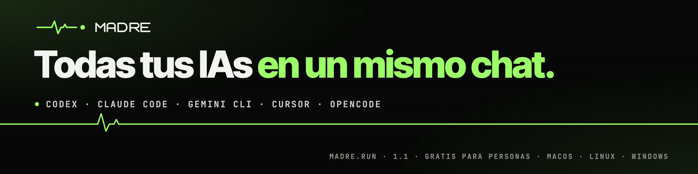
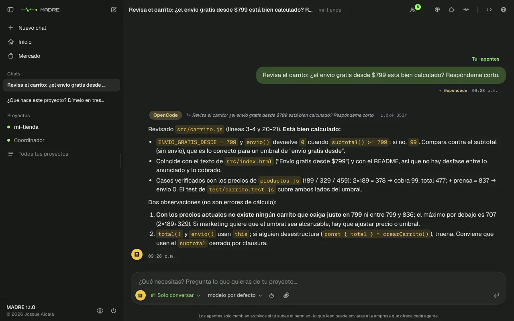
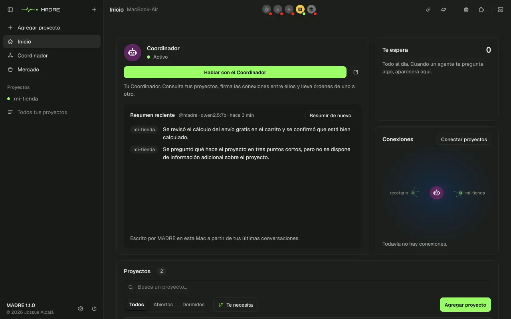
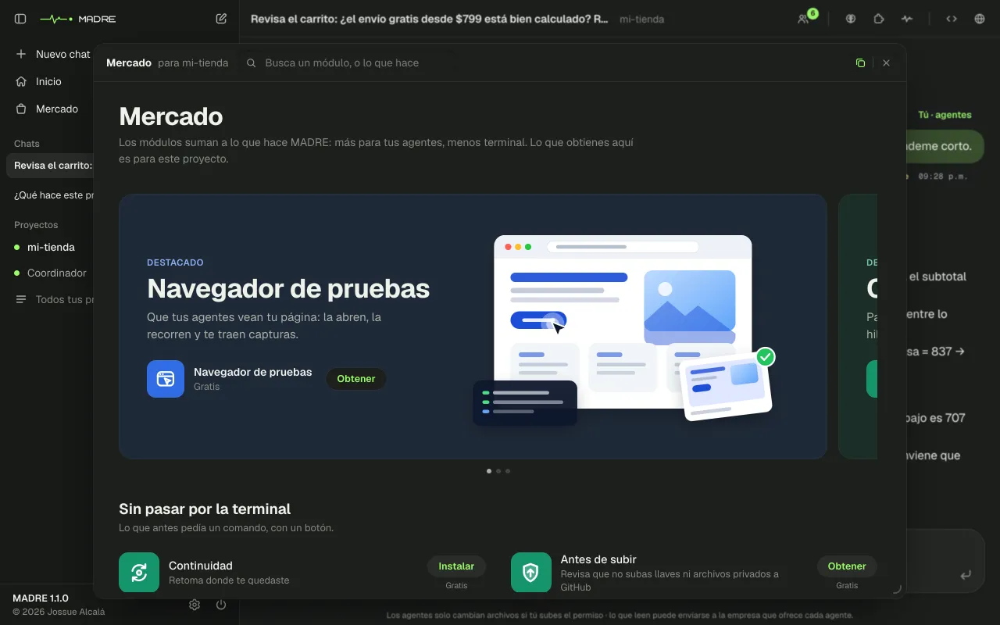
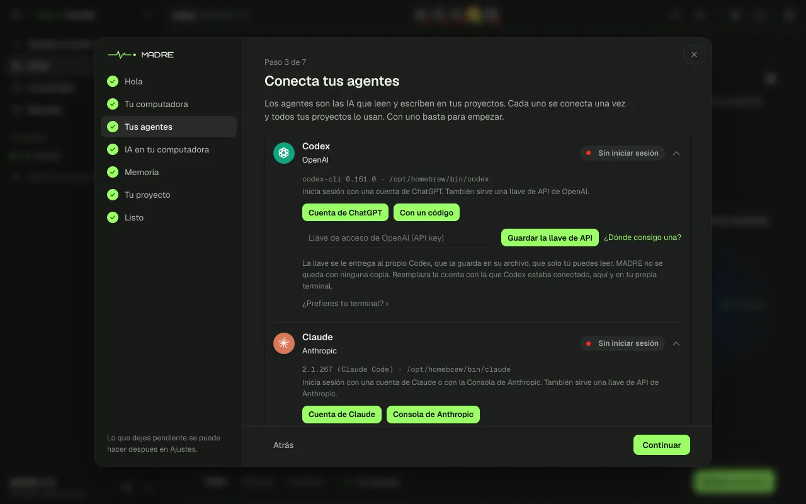
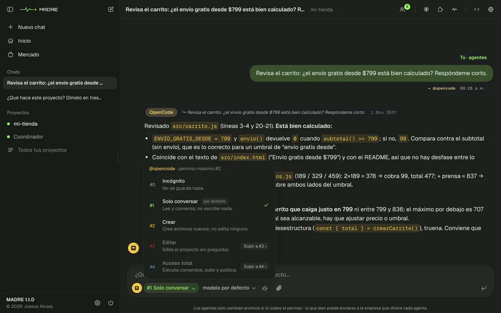

<p align="center">
  <a href="https://madre.run"></a>
</p>

<p align="center"><b>Español</b> · <a href="README.en.md">English</a></p>

<p align="center">
  <a href="https://www.npmjs.com/package/@jossuealcala/madre"></a>
  <a href="https://github.com/jossuealcacao-exe/madre/actions/workflows/ci.yml"></a>
  
  
</p>

# Todas tus IAs en un mismo chat.

**MADRE no es otra IA.** Es una app que corre en tu computadora y junta a las IAs que ya usas (Codex, Claude Code, Gemini, Cursor y OpenCode) en un solo chat, dentro de tu proyecto. Les escribes con tus palabras, cada una lee lo que dijeron las otras y tú decides qué pueden cambiar. Lo que se decide queda guardado.

<p align="center">
  
</p>

## Instálala

**macOS y Linux.** Abre la Terminal y escribe:

```
npx @jossuealcala/madre
```

**Windows.** Descarga el instalador en [madre.run/windows](https://madre.run/windows) y ábrelo con doble clic. Enciende WSL2 (el Linux que trae Windows) si hace falta, prepara el Linux de MADRE y la deja en el menú Inicio, sin terminal. ¿Prefieres la terminal? Dentro de Ubuntu (WSL2), instala Node 22 y `zstd`, y escribe `npx @jossuealcala/madre`.

Necesitas Node 22.5 o más nuevo y al menos una IA con sesión. No hay cuenta que crear. MADRE se abre en tu navegador y una bienvenida te guía paso a paso: conecta tus IAs, pone una IA gratis en tu computadora si cabe y agrega tu primer proyecto.

## Lo nuevo en 1.1

<table>
  <tr>
    <td width="50%"><br><b>Inicio.</b> Tus proyectos, el Coordinador y lo que te espera, en un solo lugar.</td>
    <td width="50%"><br><b>El Mercado.</b> Notas, Recordatorios, Antes de subir y más, con un clic.</td>
  </tr>
  <tr>
    <td width="50%"><br><b>Una bienvenida paso a paso.</b> Sin usar la terminal.</td>
    <td width="50%"><br><b>Tú decides qué cambian.</b> De solo conversar a acceso total, con deshacer.</td>
  </tr>
</table>

También: chats a un lado como en las apps de chat, Windows con WSL2 y mapas de proyectos que crecen con lo que saben. El detalle está en el [CHANGELOG](CHANGELOG.md).

## Si algo falla

Abre **Diagnóstico** y escribe lo que ves, como «Gemini no contesta». Te dice qué pasa y te da el botón que lo arregla. Sin abrir MADRE, `npx @jossuealcala/madre doctor` revisa tus IAs. Los problemas comunes están en el [manual](https://madre.run/manual/#ayuda).

## Tus datos

- **Corre en tu computadora.** MADRE no tiene cuenta ni nube: abre en `127.0.0.1`.
- **Tus llaves no se copian.** Cada IA guarda su propia sesión.
- **Sabes qué sale.** Lo que lee una IA va a su proveedor, con tu cuenta, igual que en tu Terminal. MADRE manda una vez al día un diagnóstico anónimo (qué falló y cuánto se usa, nunca lo que escribes ni tus proyectos); lo apagas en Ajustes.

## Licencia

**Gratis para personas y para equipos de hasta 10**, también si la usas para trabajar para tus clientes. Cualquiera puede probarla. Una organización más grande que la use en su trabajo, o quien quiera ofrecer MADRE como servicio, necesita una licencia comercial: escribe a hola@jossuealcala.com.

El código es público ([Business Source License 1.1](LICENSE)). No es una licencia de código abierto, pero cada versión pasa a la [GNU AGPL v3](https://www.gnu.org/licenses/agpl-3.0.html) a los cuatro años de publicarse. Las versiones hasta la 1.0.5 siguen con la licencia con la que salieron. El nombre MADRE y su logo son marcas de Jossue Alcalá ([TRADEMARKS.md](TRADEMARKS.md)).

---

[Manual](https://madre.run/manual/) · [CHANGELOG](CHANGELOG.md) · [Cómo funciona cada cosa](docs/REFERENCE.md) · [Escribir un módulo](docs/SDK.md) · [Seguridad](SECURITY.md) · [Contribuir](CONTRIBUTING.md) · [Problemas](https://github.com/jossuealcacao-exe/madre/issues)

© 2026 [Jossue Alcalá](https://jossuealcala.com)
